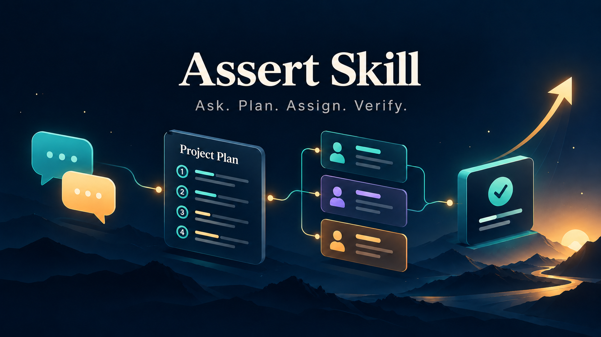
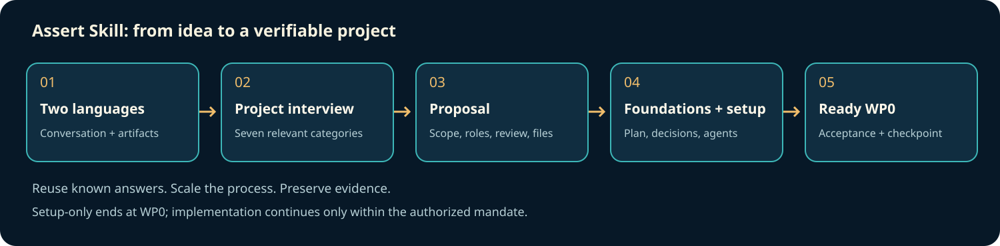

# Assert Skill

[](https://github.com/Vadale/assert-skill/actions/workflows/validate.yml)
[](https://github.com/Vadale/assert-skill/releases/latest)

**AI project kickoff, from the first questions to a verifiable work plan.**

An agent skill that interviews you, plans an AI-assisted project, selects useful
agent roles and leaves a verifiable first work package ready to run. Start with
an idea rather than an empty collection of planning templates.

**Two languages. Seven interview categories. One coherent setup.**

## Install with skills.sh or Gemini CLI

Use the cross-agent installer and select your host:

```sh
npx skills add Vadale/assert-skill --skill assert-skill
```

Or install the Gemini CLI extension from its packaged release:

```sh
gemini extensions install https://github.com/Vadale/assert-skill
```

The host must have access to the materials you explicitly select. Installation does not grant access to other projects, accounts or conversations.

Restart the assistant session and confirm the skill is visible before use.
These packaging instructions do not establish full-workflow testing in every
client, automatic model selection or a gallery ranking.

## Pi, DeepSeek Harness and Hermes

These clients can load the same complete [skills/assert-skill](skills/assert-skill)
folder. Keep its references, assets and licenses together;
copying only `SKILL.md` loses required resources.

**Pi:** install this repository as a Git package:

```sh
pi install git:github.com/Vadale/assert-skill
```

**DeepSeek Harness (DSH):** from a reviewed checkout, copy the complete
`skills/assert-skill` folder to `.dsh/skills/assert-skill/`
in your target project, or to its shared `.agents/skills/assert-skill/`
location. Choose a new destination; do not replace an existing skill silently.
DSH needs the skill folder directly under a recognized skills root, rather than
the whole repository nested there. See the
[DSH skill guide](https://github.com/deepseek-ai/deepseek-harness/blob/master/docs/subsystems/skills.md).

**Hermes:** inspect the exact source, then install through Skills Hub:

```sh
hermes skills inspect skills-sh/Vadale/assert-skill/assert-skill
hermes skills install skills-sh/Vadale/assert-skill/assert-skill
```

If catalog search has not indexed the skill, the complete folder can also be
copied to a new `~/.hermes/skills/assert-skill/` directory
(or your configured Hermes home). See the
[Hermes skill guide](https://hermes-agent.nousresearch.com/docs/user-guide/features/skills).

Reload or restart the client and confirm that `assert-skill` appears.
Native catalog/body loading was checked with Pi 1.4.0, the DSH filesystem skill
provider 0.0.1-rc.3, and Hermes source revision `e3cc65d767e3`.
These checks do not establish automatic selection, marketplace ranking or a
complete model-driven workflow. The requirements and permissions below still apply.

## Try a natural request

Once this skill is installed and visible to your assistant, try:

> Help me start a local data-quality project. Talk with me in Italian and write project documents in English. Interview me before creating files; finish with the first work package ready.

Expect the remaining interview questions, followed after your answers by an appropriately sized plan, roles and verifiable first work package. Supplied language choices are reused.

See the [synthetic input/output example](examples/natural-request.md) for expected
behavior and nearby tasks that need another workflow. Automatic selection
depends on your host and model; explicit invocation remains available.

## What happens when you start

1. Establish the language for the conversation and the language for project
   artifacts separately. The skill itself is written in English.
2. Ask the project questions that remain unanswered: identity/success, constraints
   and private material, non-goals, size, stack, distribution/license, priorities.
   Known answers are reused; deducible choices are proposed explicitly.
3. Propose the structure: roles and available model tiers, review levels,
   architecture/stack, inferred choices and exact files with their purpose.
4. Prepare the plan, roadmap, decisions, project instructions and appropriate
   agent/procedure wiring. Detail only the current phase and first work package.
5. Check the actual setup and close with a runnable WP0, honest state and limits.
   If implementation was also authorized, continue within that scope.



The interview is part of the workflow, not an optional suggestion. Full coverage
means addressing every relevant category, not asking seven questions again when
you already provided the answers. For one small task, plan/decisions/state/diary
can share a concise working document. Larger projects get only useful roles and
independent checks; the skill does not invent a whole team.

When an ambiguity would change the result, cost or permissions, the skill asks
focused questions and can propose a concrete success criterion. Clear requests
need no prompt rewrite or extra confirmation. Generated project instructions
retain a compact clarification rule for later work, without repeating kickoff.

## Start a project

After making the skill available to your assistant, ask:

```text
Use assert-skill to start my project. Interview me before writing files.
My idea: a local tool that helps a small research team inspect its data.
```

Or supply both languages immediately:

```text
Use assert-skill. Conversation: Italian. Project artifacts: English.
Target: tool-agnostic. I need a new project setup, ending with WP0 ready.
My idea: ...
Allowed working folder: ...
```

An [illustrative opening conversation](examples/first-conversation.md) shows the
language gate and complete question round. [Setup contents](examples/setup-result.md)
shows what a finished handoff should contain. These examples are illustrations,
not empirical performance results.

## Make the skill available

Copy the entire `skills/assert-skill` directory, including its references
and asset. Do not install this whole repository as one skill.

| Environment | Location / use |
|---|---|
| Codex, personal | `~/.agents/skills/assert-skill/` |
| Codex, project | `.agents/skills/assert-skill/` |
| Claude Code, personal | `~/.claude/skills/assert-skill/` |
| Claude Code, project | `.claude/skills/assert-skill/` |
| Other file-capable assistant | Provide the skill entrypoint path and let it read the linked resources. |
| A conversation without local file access | Supply SKILL.md, the interview, common setup and selected adapter as files/text; supply conditional resources when needed. Documents are drafts until a real tool saves them. |

In Codex, explicitly request `$assert-skill`; in Claude Code use
`/assert-skill`. Availability/discovery depends on the host and its settings.
See [official OpenAI skill documentation](https://learn.chatgpt.com/docs/build-skills)
and [Claude Code skill documentation](https://code.claude.com/docs/en/skills) for
current host behavior. This repository neither installs itself nor configures accounts.

## What it preserves

- Your chosen goals, languages, stack, scope and existing authorization.
- A stable plan and just-in-time roadmap, with executable acceptance and fallback.
- A first-user workflow and a distinction between internal/proxy checks and
  observed usefulness, without requiring unavailable external testers.
- Three review levels scaled to actual risk; meaningful agent/model selection.
- Local project files as the source of truth, checkpoints and a useful evidence diary.
- Original files when preservation is requested, and recipient-specific public/local
  selection before sharing. It can use publication-fit-review when available.
- Complete code-simplification controls in a project-local resource, read by trigger.

R is an overridable preference for appropriate statistics. Astra Ultra is an
optional planning preference when actually available and authorized, not a required
provider or an automatically activated model. Companion skills are optional;
self-contained fallbacks cover consequential handoff and sharing checks.

## Limits and evidence

This is an instruction-and-template skill, with no runtime, server or paid API
requirement. It does not guarantee every model will follow instructions perfectly,
provide OS isolation, certify security, intercept uploads or authorize publication.
Agent/tool execution requires actual host support and current authority.

The earlier local 0.2.0 behavioral core was exercised in two synthetic scenarios: a three-turn
medium-project interview/setup and a fully answered small non-code Claude-target
setup. All 12 critical behavioral assertions passed independent evaluation.
Original fixtures stayed unchanged; the medium setup retained its first failed
receipt-link check and passed the final 15 setup checks after correction.
The previous 0.2.1 core adds narrow first-user/evidence and uninformative-iteration guidance;
one targeted synthetic planning trial passed all five critical assertions under
independent evaluation. No implementation, diagnostics or CI were executed in that
trial. The earlier cases keep their original version identity. Assert Skill 0.3.0 preserves that behavior; the new
name, invocation paths and presentation were checked separately. These are bounded
internal trials. Native Claude execution, external-user
validation and controlled token/time savings are not established. Preparing
Claude-target files is not a native Claude test.

## Related skills

The author also maintains [R statistical analysis](https://github.com/Vadale/r-statistical-analysis-skill),
[security-finding triage](https://github.com/Vadale/sec-graph-triage-skill),
[personal AI project coaching](https://github.com/Vadale/ai-project-coach-skill),
[bounded artifact approvals](https://github.com/Vadale/sentinel-action-guard-skill),
[project continuity](https://github.com/Vadale/project-continuity-skill) and
[publication fit review](https://github.com/Vadale/publication-fit-review-skill).
Use them when relevant and available; they are not prerequisites.

## Repository contents and license

`skills/assert-skill/` is the complete reusable skill. `examples/` and
`docs/images/` help people understand it. Development diaries, raw conversations,
private test cases/oracles, source manuals and local checkpoints are kept outside
this repository. Nothing depends on access to them.

Derived from the author's lean project-bootstrap method, with public-facing
English instructions and an explicit two-language opening. [MIT license](LICENSE).
The hero is AI-generated; the workflow diagram is an editable SVG. Neither image
is a product screenshot or a measured result.
